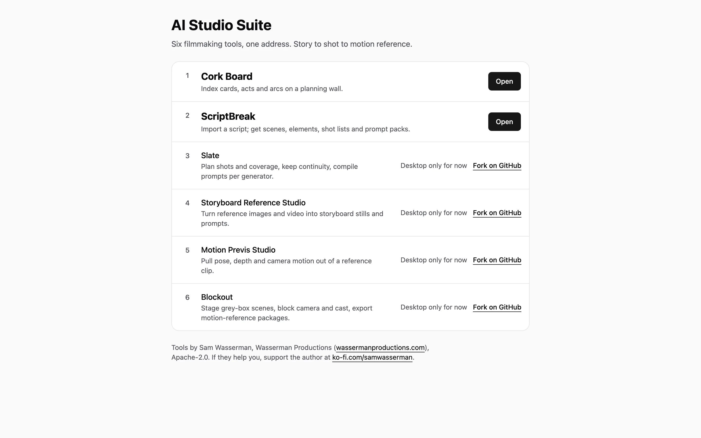
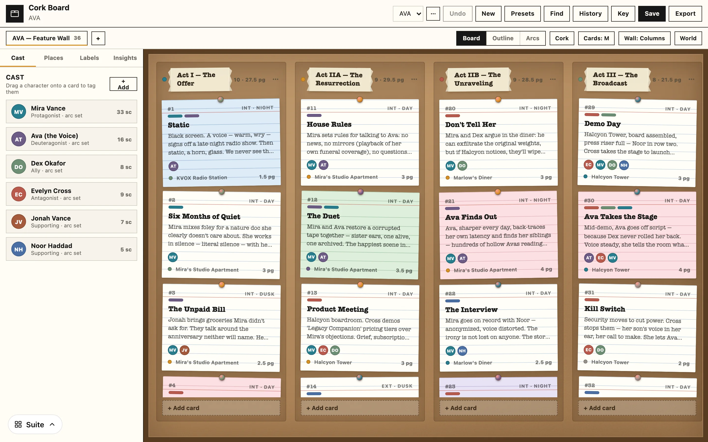
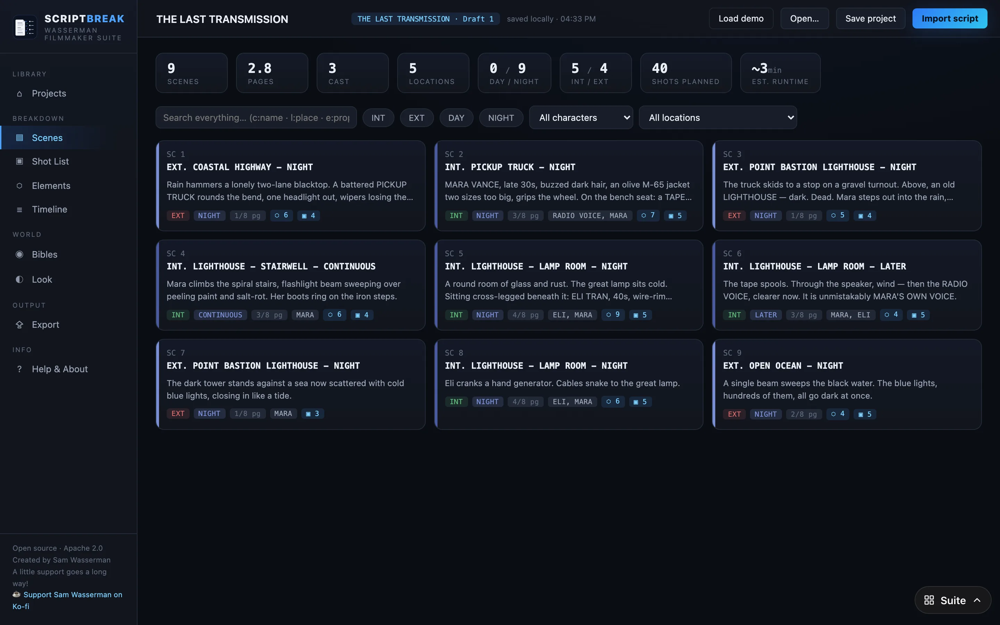

# AI Studio Suite

**Problem.** The six AI-filmmaking tools from Wasserman Productions (Blockout, ScriptBreak, Storyboard Reference Studio, Slate, Motion Previs Studio, Cork Board) are separate Electron and Tauri apps, each with its own styling and few hand-offs between them.

**Idea.** Pin each fork to a commit and build all six into one web suite at one address, then restyle them on Minimal Design System tokens without touching component code.

**Built.** The suite layer around the forks: a build that fetches the pinned fork commits into one static site, a home page and a tool-switcher pill on Minimal Design System tokens, a one-port dev gateway and Chromium and WebKit smoke tests. Exploration status: Cork Board and ScriptBreak run in the browser at https://ai-studio-suite-eta.vercel.app and the other four are desktop only for now. 35 commits on 5 days, Oct 1 to Oct 18, 2026.

**Decision.** Inside the forks the restyle swaps token values only, and `@weeeha/ui` components appear only in new suite UI, instead of rewriting existing screens on design-system components. Reuse wins every tie, and token names stay each app's own so upstream merges rarely conflict.

Personal fork of the Wasserman Productions AI-filmmaking tools, restyled on the Minimal Design System (`@weeeha/ui`) and tailored to Nick's workflow.

**Status:** exploration · **Live:** https://ai-studio-suite-eta.vercel.app (public; Cork Board and ScriptBreak run in the browser, the other four are desktop only for now) · **Started:** 2026-09-30

## Screenshots

Cork Board at `/cork/`, opened on its demo project.

ScriptBreak at `/script/` after Load demo, showing the scene breakdown.

## Run locally

Needs Node 24 or newer (`engines` in `package.json`).

- `npm run build:local` builds `dist/` from the clones in `forks/`.
- `npm run serve` serves `dist/` on http://127.0.0.1:4170.
- `npm run dev` runs every enabled tool behind one gateway on http://localhost:5170.
- `npm test` runs the build-script unit tests; `npm run test:e2e` runs the Playwright smoke tests.
- `npm run pin` writes the current `forks/*` commits into `suite.lock.json`.

## Repo map

| Tool | Fork | Upstream | Shell | Branch |
| --- | --- | --- | --- | --- |
| Blockout | [weeeha/blockout](https://github.com/weeeha/blockout) | [wassermanproductions/blockout](https://github.com/wassermanproductions/blockout) | Electron + React + three.js | `main` |
| ScriptBreak | [weeeha/scriptbreak](https://github.com/weeeha/scriptbreak) | [wassermanproductions/scriptbreak](https://github.com/wassermanproductions/scriptbreak) | Tauri, single `src/index.html` | `master` |
| Storyboard Reference Studio | [weeeha/storyboard-reference-studio](https://github.com/weeeha/storyboard-reference-studio) | [wassermanproductions/storyboard-reference-studio](https://github.com/wassermanproductions/storyboard-reference-studio) | Electron + React | `main` |
| Slate | [weeeha/slate](https://github.com/weeeha/slate) | [wassermanproductions/slate](https://github.com/wassermanproductions/slate) | Electron + React (has a web Vite config) | `main` |
| Motion Previs Studio | [weeeha/motion-previs-studio](https://github.com/weeeha/motion-previs-studio) | [wassermanproductions/motion-previs-studio](https://github.com/wassermanproductions/motion-previs-studio) | Electron + React + three.js | `main` |
| Cork Board | [weeeha/cork-board](https://github.com/weeeha/cork-board) | [wassermanproductions/cork-board](https://github.com/wassermanproductions/cork-board) | Electron + vanilla JS (Vite) | `main` |

## Local layout

- `forks/<tool>` holds a local clone of each fork, with `origin` = weeeha fork and `upstream` = wassermanproductions. It is gitignored here; each fork keeps its own history and PRs.
- Commit email for every repo is `1083934+weeeha@users.noreply.github.com` (set per repo with `git config --local`).

## Attribution

All six tools are Apache-2.0, by Sam Wasserman / [Wasserman Productions](https://wassermanproductions.com). Each fork keeps its `LICENSE`, `NOTICE` and third-party notices, and records changes in its own modifications log. If these tools help you, the author asks for a donation at [ko-fi.com/samwasserman](https://ko-fi.com/samwasserman).
